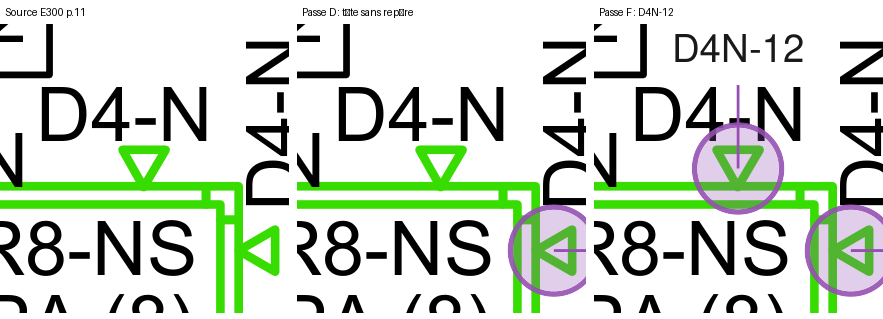

# Recalage des fonds et correction D4 — 24 novembre 2026

**G8 reste ouverte. Aucun devis client, aucune validation native Plan Expert, aucune approbation.**
Les verdicts `JUSTIFICATIONS REQUISES` conservés dans les dossiers sont ceux de la comparaison
initiale. La comparaison stricte ci-dessous les complète sans réécrire ces dossiers ni le gel.

## Comparer seulement ce qui est vérifiable

Les alias des [S-1844](../../../dossiers/S-1844/reference/recalage-pages.json) et
[S-1715](../../../dossiers/S-1715/reference/recalage-pages.json) lient le nom du document dans le QPL
et le SHA-256 du PDF d'origine. Ils ne prouvent pas l'identité du raster. Voir le
[contrat complet](../../boucle-acceptation.md#recaler-les-fonds-en-plans-seuls).

| Passe lue | Pages actives au QPL IA | Fonds humains attestés | Marques humaines hors comparaison | Marques IA hors comparaison | Verdict |
|---|---:|---:|---:|---:|---|
| S-1844 D | 12 | 0 | 716 | 199 | VÉRIFICATION INCOMPLÈTE |
| S-1844 F | 12 | 0 | 716 | 200 | VÉRIFICATION INCOMPLÈTE |
| S-1715 B | 12 | 0 | 401 | 0 | VÉRIFICATION INCOMPLÈTE |

- S-1844 : la référence du schéma E103 a un PDF et une page candidats, mais pas de JPG vérifié.
  Le PDF `23347_SELECTION_GLOBAL_SOUM_2026-08-13.pdf` auquel renvoient plusieurs pages humaines
  n'est pas dans les archives examinées. Aucune page de ce document n'est réaffectée à E300 par proximité.
- S-1715 : 154 + 82 marques sur les pages vraisemblablement AO E-201/E-301, et 6 sur la page
  vraisemblablement ELE-001 E-201. Ces **242 marques** sont hors score, jamais reportées vers ELE-002.
  Les 159 autres marques sont également hors score faute de témoins sur les rasters (11 E-102,
  106 T-201, 42 E-003 par correspondance de nom). Les lignes sans marque restent visibles dans le
  rapport par page et ne sont pas comparées en longueur.
- `files.get` a retourné 403 (portée OAuth insuffisante) même avec les ID archivés des deux avis écrits
  ELE-001/ELE-002, de la sélection globale S-1844 et du JPG E103. Le ZIP du corpus Git ne contient que
  des QPL, pas leurs rasters. Aucune permission n'a été changée. Ces vérifications n'établissent pas
  l'absence des fichiers ailleurs.

Le moteur est testé sur une paire cadrée différemment, un mauvais fond, une ancienne révision avec le
même dessin et une page humaine sans marques dont le zéro n'est pas attesté. Des rasters **témoins**
créés à partir des PDF originaux ont confirmé le contrôle sur S-1715 E-201/T-201 et S-1844 E300.
Le fond d'ELE-001 comparé à ELE-002 et le fond E300D comparé à E300 ont été refusés sur ces témoins.
Cela ne remplace pas les rasters effectivement référencés par Dupuis.

## S-1844 F : une correction sur le plan original, pas un nouveau dossier test

Sur E300 p.11, à (1909,14 ; 680,94) points PDF, le triangle vert rejoint le rail (tracé 62502),
et seul `D4-N` est centré à l'avant de cette tête. Vérifié contre E101 p.4. La règle conserve la
priorité des associations latérales, refuse le côté opposé du rail et laisse les têtes sans texte
en réserve. Le rejeu est une correction après diagnostic, avec le PDF seul comme entrée du moteur.

Le CSV et le QPL passent de **199 à 200 repères** : un D4-N de plus (26 → 27), aucun autre repère
retiré, retypé ni déplacé. Contrôle de régression visuelle : **199/199 anciennes positions conservées**,
dont 195 vignettes pixel pour pixel identiques et 4 vérifiées à l'œil (renumérotation ou bordure du
nouveau repère). Le repère ajouté `D4N-12` est sur le triangle dans le PDF produit. Ce score porte
sur le changement de rendu, pas sur l'exhaustivité du relevé. La dépose et le type des têtes sans
étiquette restent à établir. Les 17 lignes E400 et la BOM des longueurs sont inchangées : **93,41 m
horizontaux seulement**, sans câble. Le contrôle qualité reste non conforme (27 constats).

## Rejeu et preuves locales

- 472 tests locaux (exit 0). Deux exécutions de `python -m src.validation.jeu_reference` dans une
  copie jetable : résultats et comparaisons de cinq projets identiques, 0 régression. Ni la base,
  ni le gold, ni la bibliothèque commune n'ont été modifiés.
- Les 33 empreintes du [gel F](S1844-F.sha256), 33 de D, 33 de E et 25 de B sont intactes. Les deux
  rejeux de chaque comparaison stricte en sortie distincte sont identiques. Le ZIP historique est
  inchangé et reste local, comme le chiffrage de travail.
- Sous `/home/fvdev-ubuntu26/work/preuves-estimation-autonomie/` : nouvelles sorties dans
  `passes/S1844-F/`, comparaisons dans `comparaisons/recalage-pilotes-2026-11-24.kZBdRU/`,
  contrôle des vignettes dans `visuel/S1844-F-controle-differences.png` et journaux dans `validations/`.

## Conditions de reprise

Obtenir un accès de lecture aux avis écrits `Électrique_Addenda ELE-001.pdf` et
`Électrique_Addenda ELE-002.pdf`, ainsi qu'aux fonds référencés par les QPL (priorité : E103 et
sélection globale S-1844 ; E-102/E-003/E-201/E-301/T-201 S-1715). Garder les PDF de soumission dans
un nouveau dossier de qualification, et les fonds de Dupuis dans `reference/rasters/`, jamais dans
l'INBOX. Une fois les versions et le périmètre attestés, rejouer la comparaison avant de discuter
d'écarts de quantités. Les avis, la dépose, les câbles, les parcours, les prix et la main-d'œuvre
restent à compléter avant l'essai sur un dossier neuf et la décision de Francis.